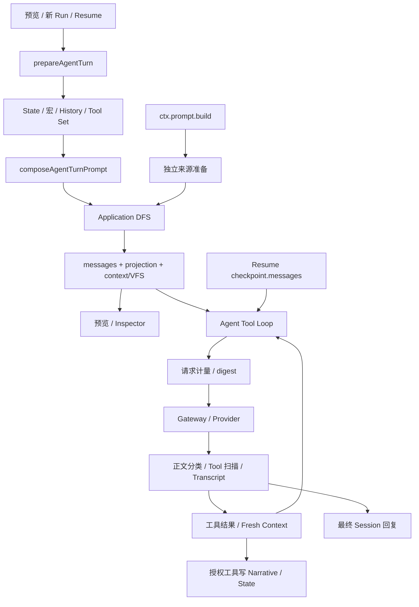

# STBridge：PromptBuild 扩展能力与 EJS / MVU 兼容计划

创建日期：2026-10-05；最近修订：2026-10-07

状态：2026-10-07 已完成约定范围的平台加工入口和受限 EJS / MVU 数据闭环，以及定向验证。MVU 使用平台 State 后端，历史 API 不做，作者脚本宿主与 UI 后置；不宣称完整 ST 生态兼容。

归属：`extensions/st-data-compat`（STBridge，Manifest ID 为 `sillytavern.importer`）。

## 1. 目标与执行边界

让采用 EJS / MVU 的 ST 角色卡通过兼容扩展运行在 LoomStudio 中，同时检验并补齐平台真正缺少的扩展能力。Loom 原生作者不必采用 ST 的世界书标签、消息楼层变量或脚本 API。

分为两阶段：

1. **平台扩展能力**：补齐 PromptBuild 的有序加工、EJS 控制本轮激活、自定义内容指令接入和最新 State 读写；核对 Agent Run、预览与恢复的消费者边界。
2. **兼容扩展实现**：在 STBridge 中接入 EJS 模板所需的最小上下文、MVU 初始化与更新规则，完成数据闭环，不以作者脚本宿主或 UI 可用作为退出条件。

两阶段已按第 9 节的受限数据层合同完成。阶段一不是重写整个 PromptBuild；阶段二不是完整重建 SillyTavern 或酒馆助手。第 6 节记录技术核对结果，不能重新将已确认事项设置为审批阻塞。第 9 节记录实际落地范围，不将局部平台测试等同于完整生态兼容。

### 已确认方向

- 保留现有有序树、Anchor / Contribution、Narrative 与 Agent Session 的边界。
- 兼容作者可观察到的语义，不照搬 ST 的事件接线、DOM 修补和全局临时变量。
- 不为了“使用 Pass”强制让业务经过 Core，也不向同步 Core 加入数据库、网络和持久化副作用。
- 已选择 MVU 运行逻辑 + 平台 State 后端：当前实现初始化、解析、内建更新/Schema 规则与持久化；作者自定义回调及脚本 API 宿主后置，不另建节点变量权威存储。
- 只支持所选 Timeline / Branch 的最新状态；“最新”是该分支当前 State Head，不是全局最新消息。ST 历史消息变量 API、swipe 映射不在当前范围，也不伪装成最新状态返回。
- 作者后台脚本、事件注册与回调执行宿主、酒馆助手通用 API、HTML 状态栏和 UI 桥均后置，不阻塞数据层。EJS 模板求值、读取最新状态和控制本轮世界书仍在范围内。
- 选择依据：用户确认 ST 的消息变量存储主要用来实现删消息回滚，Loom 应复用自身的 State Revision / 分支 / 回滚体系，而不是复刻该存储手段。具体用户操作与 Revision 的对应仍须验证，不能声称当前删正文必然自动回滚 MVU。
- 以一个兼容容器承载完整变量树，不强制把每个角色、物品拆成原生 Entity；优先评估一个 Entity 的 Component，具体路径和初始化接线属于后续最小设计。
- 保留 MVU 的自定义内容更新格式，不要求作者或模型改用 Loom 的 State tools。
- 工具后续轮次不刷新模板；不设计 Step 级模板重建。
- 不处理模型输出中的 EJS。EJS 的重点是作者模板文本、读取状态与控制本轮世界书条目，而不是新的模型输出执行器。

### 必须修正的前提

旧草案曾先强制要求 Node + State 结算，再未经决定预设 State 后端，随后开放两路线比较。现根据用户明确决定收口为 State 后端；不是因为 EC 技术限制排除独立记录，也不恢复 Node + State 必须共同提交的前提。

后续只核对数据通路与必要的 EJS 模板上下文，不重新开放存储选型，不先增加 State 底层模块。历史 API 不实现；作者脚本/UI 调研证据保留为后续资料，不再作为当前工作包或验收前置。

本文件依据当前本地工作区，不代表上游项目最新发布版。主仓库存在大量未提交修改；`extensions/` 被主仓库忽略，当前目录内未见独立 `.git`。计划已落盘不等于进入版本控制；不得顺手修改忽略规则或提交其他工作。

## 2. 当前事实与证据

2.1-2.4 保存 2026-10-05 的源码调研基线；2.5 为 2026-10-07 的定向补查。前者未在本次修订中全量重验，实施前按实际改动核对。测试文件只作为覆盖入口，未运行测试。

### 2.1 PromptBuild 本体

| 事实 | 证据与影响 |
| --- | --- |
| Agent 直接调用 Application DFS；Core Pass 不在实际构建链中 | [agent-turn.ts](../../../../packages/application-runtime/src/agents/agent-turn.ts):134；[Core 集成说明](../../../../docs/architecture/application/prompt-build/loom-core/studio-integration.md)。增加 Core Pass 不会自动影响 Agent。 |
| Source Preparation 先展开内置宏，再在 DFS 中求 Activation | [workspace-codec.ts](../../../../packages/application-runtime/src/cards/workspace-codec.ts):92；[编译器](../../../../packages/application-runtime/src/prompt/prompt-build-pipeline.ts):33。不能直接把有副作用的 EJS 放到当前宏位置，令所有启用但未激活条目提前执行。 |
| 内联 Preset 正文来自 `SourceNode.body`，挂载正文来自 `PromptContribution.content` | 同上。只改 contributions 会漏掉内联正文；同时盲改两个副本则可能重复执行模板。需要唯一的正文加工归属。 |
| Session 原生消息通过 `contribution.messages` 保留独立边界和工具字段 | [agent-turn.ts](../../../../packages/application-runtime/src/agents/agent-turn.ts):285；[session-history.ts](../../../../packages/application-runtime/src/agents/session-history.ts):16。不能只替换 `content` 摘要，也不能将完整消息 JSON 当文本执行。 |
| 当前关键词 Activation 只匹配 `currentInput`，条件依赖显式传入 facts | [prompt-activation.ts](../../../../packages/application-runtime/src/prompt/prompt-activation.ts):31。它不是 ST 世界书的完整递归扫描、概率、sticky/cooldown 引擎。增加模板执行器不等于完成世界书行为兼容。 |
| 普通贡献按 Anchor 聚合，Message 父节点决定正文 role；Native messages 只接受 Session 来源 | [编译器](../../../../packages/application-runtime/src/prompt/prompt-build-pipeline.ts)。`@INJECT role/pos/regex` 不能直接等同于现有 `roleHint/localDepth`。 |
| 构建产物还被 Context 工具、VFS 和 Inspector 消费 | [context-snapshot.ts](../../../../packages/application-runtime/src/agents/official-tools/context-snapshot.ts):5；[agent-turn.ts](../../../../packages/application-runtime/src/agents/agent-turn.ts):165。只改最终 messages 会使这些视图与模型所见不一致。 |
| Trace 的 `executions` 为空，Editor Projection 的 rows 为空 | [agent-turn.ts](../../../../packages/application-runtime/src/agents/agent-turn.ts):143；[编译器](../../../../packages/application-runtime/src/prompt/prompt-build-pipeline.ts)。目前没有真实逐阶段执行记录，不能沿用 `core-compact-1` 名称声称已有。 |

### 2.2 消费者：Agent Run 与独立构建

当前调用关系：

图中后续 Step 不返回 `prepareAgentTurn`；Resume 虽重新准备 Prompt，却优先采用 checkpoint 消息；最终 Session 回复不会自动写 Narrative。

| 消费场景 | 已确认行为 | 接入风险 / 必须保持的边界 |
| --- | --- | --- |
| Preview | `previewAgentTurn` 与 Invoke 共用 preparation；前端预览传草稿和目标分支 | [agents-runtime.ts](../../../../packages/application-runtime/src/runtime/agents-runtime.ts):301；[前端](../../../../apps/studio-client/src/features/narrative-runtime/model/use-narrative-runtime.ts):925。必须允许工作副本内先写后读，但不能持久化。 |
| 新 Run | preparation 在用户 Transcript / running Entry 追加之前执行 | [agents-runtime.ts](../../../../packages/application-runtime/src/runtime/agents-runtime.ts):350；[tool-loop.ts](../../../../packages/application-runtime/src/agents/tool-loop.ts):297。构建期间写 State 可能留下没有对应 Transcript 的修改，必须明确提交点。 |
| 多步工具调用 | 初始 Prompt 构建一次；后续只追加 Provider 消息、Tool Result 与一次性 Fresh Context | [tool-loop.ts](../../../../packages/application-runtime/src/agents/tool-loop.ts):285、319、566。State 工具读取可刷新，Prompt 前缀不会因此重建。不能默认每 Step 重跑 EJS。 |
| 工具描述 | Tool Set 在 Prompt 前编译，Native tool specs 与 messages 分离，并在 Loop 中复用 | [agents-runtime.ts](../../../../packages/application-runtime/src/runtime/agents-runtime.ts):757；[tool-loop.ts](../../../../packages/application-runtime/src/agents/tool-loop.ts):289。不得让模板绕过授权新增可执行工具，或令描述与实际工具集脱节。 |
| Resume | 重新 preparation 后，Loop 使用 `continuation.messages`；Server 创建新的 Run 身份 | [agents-runtime.ts](../../../../packages/application-runtime/src/runtime/agents-runtime.ts):350、368；[RPC](../../../../apps/studio-server/src/rpc/handlers/application/agents.ts):303。若 preparation 有副作用会重复结算；仅以新 runId 幂等也不足。 |
| 截断 / 流式 | `length` 时保存 partial 并继续下一 Step；暂停可以保存部分文本与 checkpoint | [tool-loop.ts](../../../../packages/application-runtime/src/agents/tool-loop.ts):518、641。不得逐 chunk 或把未完成模板/更新块当完整结算输入。正式架构文档仍把 length 描述为失败，与此处源码有差异，本计划以源码为准。 |
| 输出分类 | reasoning promotion 在 Content Tool 扫描之前；CodeAct 对被转换或截断的源码有拒绝执行逻辑 | [tool-loop.ts](../../../../packages/application-runtime/src/agents/tool-loop.ts):398、559。EJS/MVU 不得执行 reasoning、Tool Result 或工具代码中的伪更新片段。 |
| Narrative 写入 | 用户正文先单独落库；Assistant 正文仅由授权工具写入；最终回复只保存 Transcript | [narrative-runtime.ts](../../../../packages/application-runtime/src/runtime/narrative-runtime.ts):221；[agents-runtime.ts](../../../../packages/application-runtime/src/runtime/agents-runtime.ts):1055。此事实不要求 MVU 绑定正文节点；State 更新与正文追加分开。 |
| 计量与追踪 | 每次 Provider 调用前计算实际 Step messages + tools 的 token estimate / digest | [tool-loop.ts](../../../../packages/application-runtime/src/agents/tool-loop.ts):319。所有发送前转换必须先于计量；初始 Prompt Trace 不等于后续 Step 的实际请求。 |
| 并发 | 当前互斥按 Session，其他 Session 仍可同时执行；State 写入使用 Revision CAS | [agents-runtime.ts](../../../../packages/application-runtime/src/runtime/agents-runtime.ts):325；[state.ts](../../../../packages/application-runtime/src/state/state.ts):60。同一 Timeline 多 Session 不能依赖全局 EJS 缓存或假定分支独占。 |
| 独立扩展构建 | `ctx.prompt.build` 用空变量上下文、校验安装归属，只返回 messages；无显式 Timeline / mode / AbortSignal 输入 | [extension-prompt.ts](../../../../packages/application-runtime/src/prompt/extension-prompt.ts):70；[SDK](../../../../packages/extension-sdk/src/index.ts):659；[Runtime facade](../../../../packages/application-runtime/src/runtime/runtime.ts):92。必须明确其无状态能力边界或补充显式上下文，不能偷取“当前聊天”。 |

### 2.3 State 与扩展生命周期

- EC Contribution 最终物化为普通 JSON；可以用一个兼容组件保存 `stat_data`、MVU Schema 和初始化记录。[state-contribution.ts](../../../../packages/application-runtime/src/state/state-contribution.ts):165。
- 当前 `applyApplicationStateMutation` 创建 Revision 并推进 Branch Head，不会将已有 Node 改绑到该 Revision；正文追加取当时的 Branch State Head。[state.ts](../../../../packages/application-runtime/src/state/state.ts):102；[agents-runtime.ts](../../../../packages/application-runtime/src/runtime/agents-runtime.ts):1055。
- 从历史 Node Fork 取 Node Revision，从当前正文 Head Fork 取 Branch 最新 State Head。这是现有平台历史语义，不因 MVU 接入自动改写；不承诺复刻 ST 每个 swipe 的变量历史。[narrative-runtime.ts](../../../../packages/application-runtime/src/runtime/narrative-runtime.ts):245。
- State 与 Narrative 已能参加同一 Data Engine transaction；创建 Timeline 已原子写入初始 State、Branch 与 Opening。此事实不作为新增“MVU 正文结算事务”的需求，作者脚本也不获得 Store / transaction。[narrative-runtime.ts](../../../../packages/application-runtime/src/runtime/narrative-runtime.ts):400。
- Timeline 的绑定 Schema 在 Runtime Context 中保存。不能把会随 MVU 运行演化的自定义 Schema 原样固化成平台 Schema；外层容器校验与 MVU 内层规则需要分开。[state.ts](../../../../packages/application-runtime/src/state/state.ts):382。
- `ctx.state.read/write` 只接受 Global 或 Timeline/Branch；SDK 没有直接按历史 Node 读取的 State target。MVU 更新指令也不等于 SDK 的 `set/remove` 操作，需在兼容层计算结果，再受控提交兼容子树。[SDK](../../../../packages/extension-sdk/src/index.ts):906。
- Host 已有 capability、安装身份、作用域注销和 State 访问边界，可供新能力沿用；但能力请求不等于作者模板自动获得宿主权限。[instance.ts](../../../../packages/extension-sdk/extension-host/src/instance.ts):236、284。
- 当前 CodeAct 有 Worker + QuickJS + 显式桥接，可作为执行隔离的技术候选，不代表现有 CodeAct 业务 API 可直接给 EJS 使用，也未证明其能运行本扩展的 EJS 编译产物与库。[sandbox.ts](../../../../packages/application-runtime/src/agents/codeact/sandbox.ts):20。

### 2.4 ST 兼容现状

- STBridge 目前只做数据转换、资源导入与迁移。世界书保留标题、正文、基本 Activation，但不解释 EJS/MVU；Card 转换不保留任意酒馆助手脚本；聊天转换不保留逐消息变量 / swipe 数据。[lorebook.ts](../../src/normalizer/lorebook.ts)、[card.ts](../../src/normalizer/card.ts)、[chat.ts](../../src/parser/chat.ts)。
- EJS 实际支持异步、共享变量读写、世界书预处理、消息级顺序执行、延迟注入和渲染阶段执行；不是单纯 `<%= ... %>` 替换。`generateBuffer`、`generateData` 与最终消息位置是可观察语义。
- MVU 初始化扫描 `[initvar]`，支持 YAML/JSON、宏、多世界书与开场 `<initvar>` 覆盖；其扫描不等价于激活条目扫描。更新还包含自定义 Schema、命令解析和作者事件回调。
- MVU 与 EJS 的消息变量可能指向同一份 `stat_data`；兼容 API 必须映射到一个权威状态，不能各自维护一份可写副本。

外部源码基线：

- EJS：[模板上下文](/Users/macbookair/SillyTavern/public/scripts/extensions/third-party/ST-Prompt-Template/src/function/ejs.ts)、[生成与渲染](/Users/macbookair/SillyTavern/public/scripts/extensions/third-party/ST-Prompt-Template/src/modules/handler.ts)、[延迟注入](/Users/macbookair/SillyTavern/public/scripts/extensions/third-party/ST-Prompt-Template/src/function/inject.ts)、[变量](/Users/macbookair/SillyTavern/public/scripts/extensions/third-party/ST-Prompt-Template/src/function/variables.ts)。
- MVU：[初始化](../../../../drafts/MagVarUpdate-beta/src/function/initvar/variable_init.ts)、[更新](../../../../drafts/MagVarUpdate-beta/src/function/update_variables.ts)、[数据与事件](../../../../drafts/MagVarUpdate-beta/src/variable_def.ts)、[作者 API](../../../../drafts/MagVarUpdate-beta/src/function/global/index.ts)。
- 移植前记录本地版本/源码摘要；EJS 扩展 README 标注 AGPL-3.0，MVU 标注 MIT。是否复用源码及相应分发要求需单独核对，不能把模板引擎本身与 ST 扩展代码视为同一许可来源。

### 2.5 自定义内容协议与 UI API 补查（2026-10-07）

MVU 示例已经足以确认更新格式，不需要先等待新卡：

- [格式示例](../../../../drafts/MagVarUpdate-beta/example/理理/[mvu_update]变量更新规则.md)要求 `<UpdateVariable>` 内输出 `_.set(path, old, new)`；[extractCommands](../../../../drafts/MagVarUpdate-beta/src/function/update_variables.ts):437 还解析 JSONPatch 和其他 MVU 命令。这是待解析的命令文本，不是授权执行任意模型生成 JavaScript。
- 现有 [Content Tool Scanner](../../../../packages/application-runtime/src/agents/content-transport.ts):3 固定识别 `<loom_tool>`，配置项不能注册 MVU 方言。需要核对自定义内容处理器接入，而不是把卡的指令改写为 `official/update_state` 或 `<loom_tool>`。
- MVU 状态命令可以伴随普通回复完成。不能仅因识别到 MVU 更新就强行复用“有工具调用必继续 Provider Loop”的全部调度语义；是否需要结果回传以该协议为准。

以下作者 API / UI 证据仅供后续阶段参考，已从本轮数据闭环范围移出。作者 API 不止函数名，还包括同步性、就绪时机、回调可变性和 UI 宿主：

| 实际消费者合同 | 当前源码证据 | 兼容判断 / 待核对 |
| --- | --- | --- |
| `Mvu.getMvuData(options)` 同步返回变量表 | [global/index.ts](../../../../drafts/MagVarUpdate-beta/src/function/global/index.ts):27 | 不能直接替换成返回 Promise 的 State RPC。可评估在作者脚本启动前提供已授权的本地 State 投影，后续按 Revision 更新；它不是第二份权威存储。 |
| `Mvu.replaceMvuData` 写变量；`Mvu.parseMessage(text, old)` 克隆数据、解析并返回，不自行调用持久化替换 | 同文件:46、67 | 保留“解析”和“提交”的区别；写入经 Host 授权/CAS；parseMessage 会调用更新事件，不能误标为无副作用纯函数。 |
| `Mvu.events` / `eventOn` 回调可以修改 commands、variables，更新函数会 await 回调 | [update_variables.ts](../../../../drafts/MagVarUpdate-beta/src/function/update_variables.ts):823、876、1618；[作者示例](../../../../drafts/MagVarUpdate-beta/example_src/src/main.ts):5 | 更新前/过程回调是可等待的转换钩子，不等于 State 提交后的只读通知。跨脚本环境需明确输入输出回传，不能仅广播同名事件。 |
| `global_Mvu_initialized` 及父窗口 `Mvu` | [global/index.ts](../../../../drafts/MagVarUpdate-beta/src/function/global/index.ts):167 | 兼容环境需要正确的就绪与撤销，不应让旧卡直接访问 Loom 宿主 `window.parent`。 |
| 状态栏可能绕过 `Mvu`，直接读 `getVariables`、`getChatMessages(getCurrentMessageId())` | [教程](../../../../drafts/MagVarUpdate-beta/doc/tutorial.md):189、228；[状态栏示例](../../../../drafts/MagVarUpdate-beta/example_src/status.html):637 | 仅提供 `Mvu.*` 不足；按真实卡列出酒馆助手桥接 API。显式历史楼层读取和仅用楼层定位当前 UI 的读取必须分辨。 |
| 原生 Loom Script 只有 Renderer、异步 `state.read` / `ui.notify`，没有 MVU 对象、变量写桥或后台作者脚本 | [Renderer 协议](../../../../apps/studio-client/src/features/loom-scripts/runtime/sandbox-renderer-protocol.ts):85；[正式边界](../../../../docs/architecture/extensions/loom-script-runtime.md) | 可以复用隔离/Renderer 基建，但不是导入旧 HTML/JS 就能运行。后台变量规则脚本不应随可见状态栏卸载而失效。 |

EJS 控制器也有直接证据：[worldinfo.ts](/Users/macbookair/SillyTavern/public/scripts/extensions/third-party/ST-Prompt-Template/src/function/worldinfo.ts):782 用 EJS 求值 `@@if`，并有预处理/激活标记；[ejs.ts](/Users/macbookair/SillyTavern/public/scripts/extensions/third-party/ST-Prompt-Template/src/function/ejs.ts):43 暴露 `activewi` / `activateWorldInfo`。因此“根据变量控制本轮条目”属于主要兼容目标，而不只是文字替换。

同文件:278 确实暴露 `setvar`，但这只是源扩展的一项 API，不能据此把任意 EJS 持久写入或模型输出代码执行扩大为首版核心需求；其优先级以实际卡使用情况为准。

## 3. 最小设计方向（提案）

### 3.1 平台拥有加工合同，兼容扩展拥有语言

平台只理解处理阶段、输入来源、作用域、取消、结果与诊断；EJS 标签、世界书特殊标题、MVU 命令及 API 名称属于 STBridge。

按真实需求建立有限阶段，不预先创建通用工作流引擎或任意 Pass 图：

1. **候选准备 / 激活前处理**：保留源身份与未展开正文，为显式预处理条目调整本轮候选内容和条件；不改持久作者配置。
2. **有序内容加工与贡献收集**：保留作者所需执行顺序、模板分组和同次执行先写后读；内联正文、Anchor 内容和 Session 文本各有唯一加工位置。
3. **编排后的兼容处理**：仅承载必须依赖最终消息布局的语义，例如消息索引和正则定位。不可准确映射的旧规则不静默近似成 Anchor。

MVU 内容命令处理、UI 状态消费与 Prompt 加工是不同入口。发送前运行作者 EJS 控制脚本，不执行模型输出中的 EJS；公开合同按这些实际需求收敛，不设计通用 ST 运行时。

### 3.2 构建上下文与副作用

- 每次构建显式携带 mode、调用身份、Card / Preset / Timeline / Branch、来源版本、State 基线和取消信号；不存在进程级“当前聊天”。
- 对外可见的 source/projection 不就地污染持久资源。EJS 可读取状态、计算文本、控制本轮候选和激活结果；本轮临时变量与持久 State 写入不同。
- Preview 执行同一构建语义但不写持久状态。若实际卡需要 `setvar` 等持久写 API，再明确提交和失败语义；不为尚未需要的 API 预先建设通用副作用事务框架。
- 保留来源身份与错误位置；工具/VFS 区分原始资源和本轮加工投影，不能一方返回模板、一方声称那就是已发送内容。
- 编译缓存可评估；渲染结果缓存、跨调用共享环境和任意并行求值不作为默认优化。
- 注册沿用 Host owner / installation / scope 生命周期；安装可用、处理器启用、作品选择使用、作者脚本授权是不同条件。STBridge 全局安装不意味着扫描并执行所有用户文本。
- 有状态处理失败不得无诊断继续发送未经求值的模板。取消/卸载要停止后续执行和提交；已接受的宿主操作必须报告真实完成结果。

### 3.3 Agent 消费边界

- 已确认“一次新 Run 构建一次前缀”；工具后续 Step 不刷新模板。State 更新可以通知 UI，但不因此重建已开始 Run 的 Prompt。
- Resume 复用已接受构建产物；可以重新准备授权/工具执行上下文，但不重复运行已完成作者脚本。只在实际需要记录副作用时增加相应收据。
- Resume 的新 runId、来源 runId、Provider Step 与 MVU 更新操作身份必须分开。防止流式重放、恢复或 UI 重挂导致同一命令重复执行，不绑定到 Narrative Node 提交。
- 处理必须在 request measurement/digest 之前完成。Inspector 标识新构建、复用构建与实际 Step 请求，不把 initial projection 当全部请求记录。
- Native tool_calls、tool_call_id、reasoning 和工具协议不属于普通模板文本。Fresh Context / Tool Result 默认作为数据，不因包含 EJS/MVU 字符串而执行。

### 3.4 MVU 数据协议与最新状态

- State 兼容容器保留 `stat_data`、自定义 `schema`、`initialized_lorebooks`；显示增量字段按实际样例需要保留。不默认重写 MVU 解析/规则引擎。
- 兼容层解释 MVU Schema、模板、值与描述对等规则，不将其转换成不等价的固定平台 Schema。可用宽松外层 Component Schema 承载内部动态树。
- MVU 命令与 EJS 读取的原始变量路径映射到授权 State 子树，只修改兼容数据，不替换整个 Timeline State；沿用 Revision CAS 与幂等合同。
- 模型继续输出卡作者规定的 MVU 自定义格式。兼容处理器负责解析、执行内建 MVU 更新/Schema 规则，再提交 State；作者不必改用平台原生工具名或协议。不建设作者自定义回调宿主，也不以无效果的同名事件宣称兼容；依赖这些脚本的卡明确属于未支持范围。
- `[initvar]` 保留为作者资源，初始化在所选 Opening、用户变量等上下文明确后执行；源条目与运行结果不互相覆盖。普通 Prompt 禁用状态不能自动排除初始化源。
- 正确性单位是一次被接受的 MVU 更新操作，不要求追加正文，不能在显示刷新/历史扫描中重放。使用平台已有操作恢复 State 后，数据读取与下一次 EJS 构建读取恢复后的当前值，不另行倒放命令；这不要求提供 ST 历史 API。
- EJS 最小读取上下文与 MVU 更新使用同一份最新 State；不额外实现 `window.Mvu`、酒馆助手 API、客户端同步投影、UI 通知或后台作者脚本生命周期。
- 不实现指定历史 `message_id` / swipe 读写，也不新增消息到 Revision 的兼容映射。若不支持的调用实际到达兼容入口，明确报告，不偷偷返回当前值。
- 不引入新的存储表或“正文与变量必须一起提交”的事务作为默认方案；依据真实缺口补受控桥接。

### 3.5 MVU 存储决定与成本（2026-10-07 已确认）

**采用 B：MVU 运行逻辑 + 平台 State 后端。** 以下比较保留为此前较宽范围的决策依据，不是仍待二选一的实施分支；其中历史 API、作者脚本与 UI 成本不属于当前工作包。A 的节点关联记录不进入本次写集，不建设双后端开关。

**State 定义不是每个变量的强制前置条件。** 当前 [applyStateOperations](../../../../packages/application-runtime/src/state/state.ts):330 操作普通 JSON；[validateSnapshotAgainstDefinitions](../../../../packages/application-runtime/src/state/state.ts):424 验证已声明绑定，不要求所有新路径逐项注册 Definition。EC Contribution 的 Template / Mount 是声明式初始化与 Schema 的组织方式，不等于底层只能存 EC 数据。既有绑定若覆盖目标父路径，仍需满足该绑定 Schema；“可以存 JSON”也不等于已经完成作者 API、权限与初始化接入。

**正文节点当前没有任意 metadata 字段。** [NarrativeNode](../../../../packages/application-data/src/narrative/types.ts)只定义正文、State Revision、来源等固定字段。A 路线可评估 Timeline scope 下的 Extension Record，以 `narrative-node` binding 关联正文；这是逻辑上的节点附属数据，不是直接向 Node 塞未知字段。[扩展数据合同](../../../../docs/architecture/application/extension/data-and-portable-payload.md)和 [storage.ts](../../../../packages/extension-sdk/extension-host/src/storage.ts):151 已提供记录创建、版本校验与关联目标校验，因而 A 不需要从零建设数据库。

| 比较项 | A：MVU 自有运行语义 + 节点关联 Extension Record | B：MVU 运行语义 + 平台 State |
| --- | --- | --- |
| 数据与规则 | 保留完整 MvuData，由兼容层管理节点对应的状态及当前值选择 | 同样保留完整 MvuData；兼容层处理规则，State 管 Revision / Branch Head |
| 定义成本 | 不需要 State Definition；仍需导入/initvar、记录组织与版本处理 | 不必逐变量 EC 化；可选一个外层组件，内部继续使用 MVU Schema |
| 旧 UI / 历史 API | 按节点取变量更贴近消息变量，但仍需消息编号、swipe、分支路径映射 | 当前变量读取直接；历史 message_id 需映射到 State Revision，SDK 当前没有按 Node 读 State 的 target |
| 分支与正文编辑 | 节点可共享，但须确认继承与更新可见性；编辑路径产生新 Node ID，不能假定记录自动复制 | 复用现有 State 分支历史；仍须验证旧 UI 期望的“此消息状态”与 Node Revision 时点一致 |
| 平台消费 | EJS / UI 经兼容桥消费；原生 State 消费者不会自动看到记录内容 | 原生 State 读取可访问兼容树，但不会自动理解 MVU 内部 Schema 或获得专门编辑 UI |
| 存档与查询 | 接入 archive participant 并重映射绑定；当前 records.list 先按包收集再过滤，不宜未经测量就承诺大量逐节点记录查询性能 | Timeline archive 已包含 State scope / revisions；MVU 数据中若嵌入旧消息标识，仍需处理其迁移语义 |
| 共同成本 | 自定义内容协议、作者后台脚本、同步 API 投影、可变事件、安全隔离、更新去重均需解决 | 同左，选 State 不会省掉这些兼容工作 |

上述分支/编辑证据为 [narrative-runtime.ts](../../../../packages/application-runtime/src/runtime/narrative-runtime.ts):234、245；当前 edit 路径返回 replacements，未在该路径复制扩展记录。存档已有 [participant 合同](../../../../packages/application-runtime/src/archive/timeline-archive.ts):165 和 Node ID map，不必新造存档框架；但不能把“存在 binding”当成已完成自动导出/重映射。State 导出见 [narrative-runtime.ts](../../../../packages/application-runtime/src/runtime/narrative-runtime.ts):67；记录筛选见 [extensions-runtime.ts](../../../../packages/application-runtime/src/runtime/extensions-runtime.ts):456。

**决定后的边界：** 复用 State 的收益是避免维护第二套变量历史。需证明已有回滚/分支操作恢复兼容子树后，数据读取与下一次 PromptBuild 读取恢复后的当前 State；不增加 UI 验收或 ST 历史查询。依赖历史 API、作者脚本的卡明确不属于当前支持范围，不自动退回 A。遇到必须改变平台历史或权限合同的情况，再提出具体问题。

### 3.6 EJS 引擎与隔离运行依赖（调研时提案，实施结果见第 9 节）

区分三层，不将“装 EJS”当成运行兼容完成：

1. **模板引擎**：建议引入上游 `ejs`，由 STBridge 拥有依赖，不手写标签解释器，也不让通用 PromptBuild 依赖 EJS。当前 Loom 的根/Runtime/STBridge manifest 与锁文件未发现 EJS。源 ST 扩展直接导入 vendored [ejs.js](/Users/macbookair/SillyTavern/public/scripts/extensions/third-party/ST-Prompt-Template/src/3rdparty/ejs.js)，其中标注 3.1.9；不据此直接锁旧版，也不假定其与上游原版完全一致。先比较编译行为并选定版本，保留来源许可。
2. **JavaScript 隔离执行**：现有 Runtime 已依赖 `quickjs-emscripten` 0.32.0，[CodeAct Worker](../../../../packages/application-runtime/src/agents/codeact/sandbox-worker.ts)提供独立 VM、内存/栈限制、中断与 Promise job pump；[宿主](../../../../packages/application-runtime/src/agents/codeact/sandbox.ts)有取消与显式方法桥。优先验证这套技术可复用，不新增第二套 VM 依赖，不直接将 EJS 接成 CodeAct 工具。EJS 自身不是安全沙箱；导入卡的代码不得在宿主 Node / 浏览器主页面直接执行。编译、渲染和可配置回调都必须有明确的隔离边界，不能只隔离最后一次函数调用。
3. **兼容上下文**：`getvar`、`activewi` / `activateWorldInfo`、世界书查询、`print` 等是源扩展封装，不是 EJS 自带能力。源 [evalTemplate](/Users/macbookair/SillyTavern/public/scripts/extensions/third-party/ST-Prompt-Template/src/function/ejs.ts):127 默认 async/client/_with/print；必须验证所选 EJS 版本与这些行为的差异。`_`、`z` 等库仅按实际脚本需要打入 guest；`$`、toastr、父窗口和 DOM 不能被当成 Prompt 执行环境的默认权限。UI Renderer 与 Prompt 脚本隔离环境分别承担各自职责。

最小技术验证：在隔离环境里加载所选引擎，执行文本插值、原样输出、异步模板、读取预载 State、调整本轮激活，以及必要 include；检查结果与源扩展一致，取消/无限循环可终止，且模板不能访问宿主文件、网络或凭据。include 若纳入范围，只能通过授权资源解析，不能沿用任意文件路径加载。此验证尚未执行，不承诺 QuickJS 现有封装无需修改即可承载 EJS。

以上结论来自本地 vendored EJS 源码和现有 QuickJS 集成；本轮在线查询未返回可用正文，不据此断言上游最新版本或支持范围。当前不确定项是版本行为差异、guest 库打包与 API 桥，不是要求引入新的语言解释器或整套 ST 运行时；实施前另行核对所选上游版本。

## 4. 两阶段工作包

以下为已授权范围内的候选写集。确切新增文件按确认后的最小合同决定，不为占位创建空模块。

### 阶段一：平台扩展能力

| 工作包 | 工作与文件边界 | 完成条件 |
| --- | --- | --- |
| P1. 加工合同 | `packages/application-runtime/src/prompt/`、`cards/workspace-codec.ts`、`agents/agent-turn.ts`；明确阶段、唯一正文归属、来源与 Trace | 用不依赖 EJS 的测试处理器改变目标正文/贡献；未参与作品与未授权内容不执行；既有骨架顺序与来源保持。 |
| P2. SDK / Host 接入 | `packages/extension-sdk/src/index.ts`、`extension-host/src/{instance,types}.ts` 及实际 Manifest 校验入口；Runtime facade / context；Server 仅组装 | 注册、授权、冲突、注销与调用取消有效；不开放 Store、凭据或任意 RPC 给模板。独立 `ctx.prompt.build` 的能力边界明确。 |
| P3. Agent 与内容协议接线 | `runtime/agents-runtime.ts`、`agents/tool-loop.ts`、`agents/content-transport.ts`、`types.ts`；必要时 Server Run handler | 提供自定义内容格式接入；不硬编码 MVU 到通用 scanner，不强迫 MVU 更新再调用一次 Provider；Preview、恢复、计量保持正确，工具轮次不刷新模板。 |
| P4. 最新 State 接入 | 复用 State Service 与现有初始化合同；必要的运行上下文接线 | MVU 受控写与 EJS 读取落到同一 Timeline / Branch 的当前 State；不修改 Client Renderer、iframe bridge，不建设作者回调宿主。 |
| P5. 消费视图与文档 | `agents/official-tools/context-snapshot.ts`、必要的 VFS 投影；相关 Architecture 与局部 README | 模型输入、工具上下文与 Trace 可解释一致；不把原始模板或初始 Trace 冒充实际请求。不默认新增大型 Inspector UI。 |

P4 只服务数据闭环，先证明哪些已有能力可直接复用。初始化通过 State 接入，只有实际入口缺失才扩展；不默认修改 State 底层或 Narrative Store。公共类型变更只更新直接调用者，不扩大到作者脚本宿主或 UI。

阶段一退出条件：不依赖 ST 库的假处理器已走通真实消费者；公共合同与开放问题收口。不能仅测试一个脱离 Agent 的 Pass。

### 阶段二：STBridge EJS / MVU

| 工作包 | 工作与文件边界 | 完成条件 |
| --- | --- | --- |
| C1. 兼容输入与来源 | 扩展 `src/normalizer/`、`src/types.ts`、`src/index.ts` 与 fixtures；必要的 Artifact metadata 合同 | 保留原始书/条目身份、模板阶段与初始化源；导入不执行任意代码；不可支持项明确诊断。 |
| C2. EJS 执行与 API | 扩展新增最小 EJS 适配模块，Manifest / package 按实际需要调整 | 作者文本模板、状态读取、世界书条件/激活控制、必要的异步和注入语义正确；不处理模型输出 EJS。 |
| C3. MVU 数据运行适配 | 扩展新增初始化、自定义内容命令/Schema 适配与最新 State 读写 | 原有更新格式无需修改即可更新 State；保留解析与持久化区别、内建更新/Schema 规则；只有一份权威数据，不接作者自定义事件回调。 |
| C5. 样例验收与发布说明 | fixtures、相关测试、扩展 README / 本 Plan | 以选定实际卡完成兼容矩阵；清楚列出未支持 API、世界书语义和旧会话迁移边界，不宣称全生态兼容。 |

原 C4（UI 与作者脚本消费）整体后置，不保留当前占位实现。阶段二退出条件：选定数据样例走通初始化、EJS 读取/激活、MVU 更新、重新读取与持久化恢复，正常 Loom 卡不受影响；不以状态栏显示或完整角色卡脚本兼容为前置。

## 5. 最小验证账目

前期调研只核对源码与文档；当前实施按下表选择定向验证，实际结果记录在第 9 节，不要求每次全部运行。

| 风险 | 必需的最小行为证据 | 现有入口 / 补充位置 |
| --- | --- | --- |
| 漏加工、重复加工、顺序变化 | 内联 Entry、挂载贡献、Session 文本各执行正确次数；父 Message role 与来源不变 | `tests/unit/prompt-builder/compiler.test.ts`；新增聚焦阶段处理测试 |
| 原生工具协议损坏 | Native 调用与 Result ID 配对、Content Tool 源码不被模板改写，History Replay 保持 | `tests/integration/application-runtime/session-history.test.ts`、`native-tool-loop.test.ts` 中相关用例 |
| Preview / 独立构建误写 | 工作副本的先写后读正确，持久 Revision 不变；无上下文的请求明确拒绝所需能力 | `tests/contract/extension-host/prompt-model.test.ts`、`tests/unit/prompt-builder/extension-prompt.test.ts` |
| 多步与 Resume 重复更新 | 工具循环不刷新模板；同一 MVU 更新不因 length、Pause/Resume 或重放重复提交 | `native-tool-loop.test.ts`、`tests/unit/studio-server/agent-run-rpc.test.ts` 增加真实处理器用例，不能只 mock SDK |
| 计量/Inspector 不一致 | digest 对应最终发出的 messages/tools；Resume 不展示未发送构建为实际请求 | Tool Loop 的最小 fake-provider 集成场景 |
| 自定义指令与变量写入 | 不改 MVU 格式；普通回复与命令共存；并发冲突不覆盖其他写入；不无故多调用 Provider；无正文也能更新 State | 内容协议/Tool Loop 聚焦场景与 State 测试 |
| 当前状态与持久化恢复一致 | 更新并重新加载后仍读取提交值；已有回滚/分支操作后，兼容子树与 EJS 下一次读取一致；分支切换不串值 | State / Narrative 聚焦集成场景，不涉及 ST 历史 API 或状态栏 |
| EJS 引擎与隔离组合 | 第 3.6 节所列编译/异步/激活行为一致；可取消，不暴露宿主资源 | STBridge 最小 guest 执行验证；不能只单测宿主 ejs.render |
| 初始化和 MVU 路径差异 | 禁用的 init 条目、YAML/JSON、多书合并、宏和开场覆盖；一次更新后 EJS 能读取结果 | `tests/extensions/st-data-compat/`、`opening-selection.test.ts` 的选定 fixtures |
| 隔离和生命周期 | 无授权不执行；超时/取消/卸载停止后续宿主操作；不同 Card/Session 不共享工作变量 | Host 合同与所选执行隔离方案的定向测试 |
| 原生体验回归 | 不采用兼容能力的卡输出不变；既有成功工具提交不随之后失败撤销 | 相关 `default-preset` / `native-tool-loop` 既有用例，按变更选择 |

主要数据样例至少覆盖：世界书 initvar → State 初始化 → EJS 读取最新值并控制本轮条目 → 原始 MVU 格式更新 → 持久化后重新读取 → 下一次构建使用新值。另验证平台已有回滚后的当前值，以及一条工具后续 Step / Pause-Resume 去重场景；不测试 ST 历史 API，不把新增正文节点设为通用前置条件。

使用本地 MVU 数据示例和选定 EJS 条目作为 fixture，无需等待完整 UI 卡；不能由数据测试推断完整生态覆盖率。自动化使用本地 fake provider，不默认调用收费模型；本阶段不包含状态栏或人工视觉验收。公共 SDK 类型改动再做相关包 typecheck；新增依赖/入口后才做对应 build。

## 6. 决策与剩余样例需求

2026-10-07 已确认：

- A0 已关闭：采用 MVU 运行逻辑 + State 后端，复用平台回滚，不建设节点关联 MVU 权威存储。原 D3 的强制 Node + State 结算前提仍撤回。
- 原 D4 关闭：工具轮次不刷新模板。
- 原 D1 的模型输出 EJS 项关闭：不处理这类内容，只兼容作者提供的 EJS 模板/控制脚本。
- 原 D2 降为按需 API 核对：`setvar` 是源扩展的可选能力，不以其为 EJS 主要目标，也不预先要求通用持久副作用框架。
- 保留 MVU 自定义内容更新格式，模型不需要改用 Loom State tools。当前目标收敛为数据闭环。
- A1 后置：作者脚本宿主、回调事件、通用酒馆助手 API 与 UI，数据闭环完成后再讨论。
- A2 关闭：仅处理所选分支最新状态，不实现历史消息/swipe API，不做历史标识映射。

以下数据闭环技术核对已关闭，具体支持边界与证据见第 9 节；真实 UI 卡、历史 API 或作者脚本能力不作为本阶段阻塞：

| 编号 | 技术核对 | 实际结果 | 影响范围 |
| --- | --- | --- | --- |
| A3 | EJS 最小模板上下文与激活顺序 | 已验证最新 State 读取、模板文本、预处理和当前唯一可用条目的显式强制激活；不实现完整 ST 递归扫描或持久写。 | P1/C2 |
| A4 | 初始化与内建更新规则的可独立复用范围 | 已从用户提供的本地源码快照提取内建解析、Schema 和更新规则，在 Worker 中执行，State 持久化；移除 ST 存储、UI 与作者回调。资源刷新不重置已有 State。 | C1/C3 |
| A5 | EJS 引擎与既有隔离技术能否组合 | 已验证 EJS 3.1.10 在 QuickJS 0.32.0 guest 内编译和异步执行、限时与取消；不开放网络、文件或宿主 DOM。 | P2/C2 |

当前没有阻塞本阶段交付的架构决策。新导入资源的初始化、常规 MVU 内容更新与 EJS 最新状态消费已完成；旧会话变量迁移、额外模型模式、任意网络/DOM 能力不作为数据闭环的默认组成。

本地已有 initvar / MVU 命令示例可继续支撑数据层研究与验证，不要求哥哥现在提供 HTML 状态栏或作者后台脚本。后续启动 UI / 作者脚本工作时再收集相应代表卡与外链源码。

## 7. 非目标与停止条件

- 不改写 Core 为异步工作流引擎，不给 Provider Adapter 增加 EJS/MVU 知识。
- 不默认实现完整 ST 世界书扫描器、酒馆助手 API、浏览器宿主 DOM 环境或全局兼容变量系统；按真实卡支持必要接口。
- 本阶段不实现历史消息变量 API、作者脚本宿主、作者自定义更新回调、状态栏、iframe UI 桥或客户端同步状态投影；第 2.5 节资料不得被当作当前实现清单。
- 不把导入成功、EJS 能编译、State 能存 JSON 分别当作“卡已可用”的证明。
- 不复活 Assistant 最终回复自动写 Narrative 的旧行为；MVU 更新直接进入 State，不依赖增加正文节点。
- 不用 DOM render 或历史重扫描触发 MVU 更新；明确区分自定义命令执行、可变规则回调与提交后通知。
- 不改动已有未提交代码、数据库、忽略规则或发布配置；不自动提交、推送或安装第三方扩展。
- 需要新增持久化表、改变权限/历史语义、跨域补偿机制或扩大 API 兼容面时，记录证据并暂停对应工作包。
- 没有真实兼容样例时，只能验收平台合同和已列 fixtures，不能宣布生态兼容完成。

## 8. 任务状态与本轮验证

- [x] 核对 STBridge、EJS、MVU 的当前实现入口。
- [x] 追踪 PromptBuild 来源、编译器、工具/VFS/Inspector 消费。
- [x] 追踪 Agent Preview、新 Run、多 Step、截断续写、Pause/Resume、Narrative 写入与 State 边界。
- [x] 写入两阶段计划、候选写集、验收和开放决策。
- [x] 按 2026-10-07 讨论保留 MVU custom content 格式，关闭轮次刷新与模型输出 EJS 议题。
- [x] 补查 Mvu API、可变事件回调、示例状态栏和当前 iframe bridge。
- [x] 撤回预设 State 后端，核对 Definition、Node 字段、Extension Record 与存档入口，补入两路线成本比较。
- [x] 根据后续明确决定关闭 A0，采用 MVU 运行逻辑 + State 后端，补入回滚与投影一致性验收。
- [x] 核对 EJS vendored 引擎、Loom 已有 QuickJS 依赖与隔离实现，记录最小依赖建议。
- [x] 按最新决定收敛为最新状态的数据闭环，关闭历史 API，后置作者脚本与 UI，移除对应工作包和验收前置。
- [x] 使用本地数据样例收敛 A3-A5：EJS 最小上下文、MVU 内建规则分离与隔离组合。
- [x] 完成所选 EJS 版本与隔离执行环境的最小组合验证。
- [x] 阶段一实施与定向验证。
- [x] 阶段二实施与真实样例的数据层验收；不包含 UI / 作者脚本。

历史记录（仅计划阶段）：2026-10-05 新增本计划并检查当时的 51 个本地链接；2026-10-07 实施前修订协议/API 与存储路线，根据用户决定收口为 State 后端，并检查当时的 77 个本地链接。该阶段未修改业务代码或安装依赖，未运行应用测试/类型检查/构建，EJS + QuickJS 组合当时尚未验证。后续实施及实际验证结果见第 9 节，以该节为当前状态，不以全部勾选代替证据。

## 9. 实施记录（2026-10-07）

### 第一批：平台作者正文加工

最小实现归属：

- SDK `prompt-processing.ts` 定义按构建创建的会话、候选准备补丁与正文渲染；`ctx.prompt.registerProcessor` 负责注册，不包含 EJS/MVU 名称。
- Application `prompt-processor-registry.ts` 管理注册、Card 作用域和注销取消；`process-prompt.ts` 在克隆的来源上准备候选，再按 DFS 编排顺序加工实际发送正文。同步编译器共享同一编排/消息生成逻辑，不另造 Core Pass。
- `capabilities.processorId` 是资源显式采用标记；普通宏在被选择的语言处理器完成后展开。内联正文和贡献副本只加工一次，原生 Session/工具消息不执行。
- Agent Preview、新 Run、独立扩展构建与 Server Host 已接线；工具上下文使用加工后的副本。带处理器的恢复点保存来源与投影快照，Resume 不重跑处理器，工具上下文不退回原始模板。

第一批结束时的实现边界（第二批已继续落地，见下文）：

- P1/P2 的最小加工合同、SDK/Host/真实 Agent 接线已落地；P3 仅处理了 Prompt 消费与恢复部分，MVU 自定义内容协议尚未接入。
- 处理器注册需要 `prompt.process`，Timeline State 快照另需 `state.read`；没有暴露 Store 或写 State 方法。可信扩展回调不等于隔离作者脚本，EJS 沙箱尚未接入。
- 独立 `ctx.prompt.build` 明确使用无 Timeline 的 preview 上下文，并传递取消；没有新增“当前聊天”隐式取值。
- 尚未安装 EJS、移植 MVU 内建规则、初始化世界书变量或实现 MVU -> State 更新，不宣称数据闭环已完成。
- 工作区开始时主仓库干净；扩展目录仍被主仓库忽略，未修改忽略规则。

后续按原计划继续 P3 的自定义内容处理与 P4/C1-C3 数据闭环，不需要重新决定存储、历史 API 或 UI 范围。EJS/MVU 未落地前，不自动给导入资源添加 processorId，避免让现有卡误依赖尚不存在的处理器。

第一批验证：6 个定向测试文件共 65 项通过（编排、处理器、Host、真实 Agent、工具循环与持久恢复）。SDK/Host 定向构建通过。默认 Runtime/Server 构建受已有 `run-recovery.ts` 的 `findLast` 与 ES lib 配置不匹配阻塞；未顺手修改该配置，Runtime 使用 `--noEmit --lib ES2023,DOM` 的定向类型检查通过。`git diff --check` 通过。尚未执行真实 EJS/MVU fixture、浏览器或完整 CI。

### 第二批：数据闭环与可加载产物

- P2/P4：State Contribution 新增受控 `initialize` 回调，只替换本 Contribution 的模板初值；上下文包含选定开场、已展开普通宏的世界书及原始条目身份。初始化结果仍由现有 Timeline 初始事务保存，没有新增 State 存储表。
- P3：SDK / Host 增加 `state.registerContentHandler`，需要 `state.processContent`、`state.read` 和 `state.write`。只有 Timeline 已采用的 Contribution 会进入处理；Card 作用域、注销取消、JSON Pointer 子树写入、CAS 与幂等均受平台约束。
- P3/P5：完成无工具助手回复的数据处理入口，排除 reasoning / tool input / tool result，长度和暂停续写先合并。`content` 检查点记录已接受的精确 State 操作；该阶段恢复不重跑扩展解析器或 Provider。热/冷恢复均携带已加工 Prompt 和已接受操作，不重跑模板或已接受命令。原生工具恢复仍有明确区别：活跃进程中的终止交接使用已配对的工具结果发起新的 Provider 请求，不重放旧工具；持久检查点的 `tools` 阶段遇到不确定结果则拒绝自动恢复。
- C1：导入器标记 EJS / MVU 宏资源，保留 worldbook / UID / 主初始化来源；MVU 卡显式采用 Contribution。普通未采用资源不执行。主世界书角色标记属于去重语义，不与普通共享书强制合并。
- C2：EJS 3.1.10 + QuickJS 0.32.0，编译与执行都在 guest；未给作者文件、网络、DOM、凭据或 Store。支持 EJS 标签、异步/print/lodash、最新变量读取、预处理和本轮强制激活。State 宏展开在模板执行之后，变量里的 EJS 保持数据，不递归编译。
- C3：一个 Entity 的 `data` Component 承载完整 MvuData。MVU 内建解析/更新/Schema/VWD/模板逻辑通过可复现提取保留，源码哈希和 MIT 许可在 `src/runtime/vendor/mvu/`。去掉 ST 消息存储、UI 通知和作者事件回调；错误保留为数据诊断。规则计算在独立限时 Worker，持久化交给平台 State。
- C5：已覆盖初始化、EJS 读取/条件控制、原始 MVU 更新、数据库重开、原生回滚、流式/长度续写、热/冷恢复、防重复、权限/卸载。真实上游 `example/artifact/青空 理.png` 内存探针已完成：初始好感度 0，原始 `_.add` 更新到 5，仅一次固定 Provider 回复；Prompt 不残留当前变量宏。导入仍产生 5 条现有正则兼容诊断，不宣称该卡的 UI/作者脚本可用。
- 构建修正：实际 Host 复制到隔离目录且排除 `node_modules`，原 `tsc` 入口不能独立加载。扩展 build 现打包服务端、客户端、Worker、EJS/lodash guest 资源和 QuickJS WASM，并收集发布许可。实际 Server 导入/启停测试使用正确的 `extensions/` 开发目录。
- 原默认构建的 `findLast` 问题在本次已修改的恢复模块中改为等价倒序查找，没有改全局 ES lib 配置。

### 支持边界与验证账目

当前契约是“完整无工具助手回复自动更新”，不是通用后台命令执行器。带工具调用 Step 的旁白不自动更新 MVU；
后续 Step 不刷新 EJS。若要让工具 Step 同时执行 MVU，需单独定义内容操作与工具操作的恢复顺序，不能静默扩大。

`activewi` 仅支持显式强制激活当前可用唯一候选；非强制调用所依赖的 ST 扫描、disabled 候选复活、关键词模板、
最终消息定位注入及其他装饰器未实现。文件 include、持久 EJS 写、作者回调、历史 API、UI 与旧聊天快照迁移保持非目标。
旧导入资源未批量迁移。部署独立仓库/发布流水线和大量模板的性能验收不属于本次验证结果。

已完成的证据：

- 主仓库初次完整定向运行：12 个文件 98 项通过。热恢复调整后的复跑发现 1 项原生工具活跃交接回归（97 项通过）；修复后对 `native-tool-loop`、`agent-run-recovery`、`st-data-compat` 三个文件复验，43 项全部通过。未再次重跑未受该修复影响的其余文件。
- ST 扩展最终定向运行：importer / regression / server 共 3 个文件 26 项通过，其中 Server 9 项包含实际隔离 Host 的 MVU 初始化和停用回归。
- SDK / Host / Runtime / Server 定向 TypeScript 构建通过；扩展打包 build 通过。
- 上游真实卡探针通过；不请求外部模型、不执行状态栏或后台作者脚本，不改原卡。
- 主仓库变更通过 `git diff --check`；扩展目录仍被主仓库忽略，源文件与打包产物已保存在本机，未修改忽略规则或自动提交。
- 尚未执行完整仓库 CI、真实模型生成、UI/视觉验收或发布安装包下载测试；本任务没有修改 UI。
